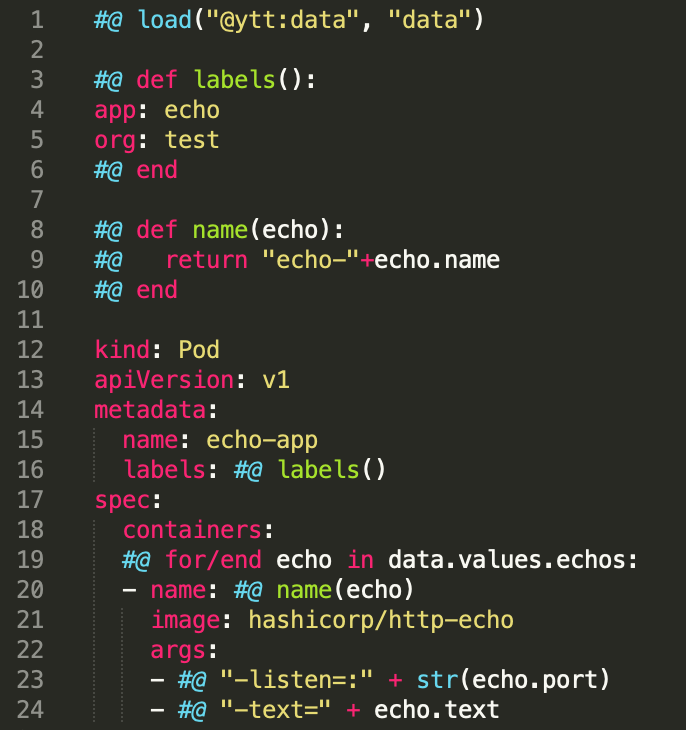

# SublimeText ytt syntax higlighting

Simple syntax higlighting for [Carvel tools ytt](https://carvel.dev/ytt/) in [Sublime Text](https://www.sublimetext.com/).

Depends on YAML package that is included in ST. [Starlark syntax](https://github.com/Vasfed/sublime_starlark) and ApplySyntax(see usage) packages are highly recommended. Screenshot shows this syntax effect when Starlark is also installed (ytt uses starlark after `#@`).



## Installation

The recommended way is to use [Package Control](https://packagecontrol.io/installation) to automatically receive the latest updates and make the entire process much simpler.

### Package Control Installation
(this should work once [pull request is accepted to Package Control](https://github.com/wbond/package_control_channel/pulls?q=is%3Apr+author%3AVasfed+ytt))

1. Open Sublime Text and press `Shift+Ctrl+P` (`Cmd+Shift+P` on Mac).
2. Type `install` and press enter.
3. Another text box should appear, type `ytt` and you should see this plugin highlighted. Press Enter to install it.

### Manual installation

1. Download this Git Repository's master branch as a .zip file. (Or you can download the latest release.)
2. Navigate to `Preferences > Browse Packages...` (or `Settings -> Browse Packages...`)
3. Put the folder from the .zip into the location that was opened.
4. Restart Sublime.

## Usage

Use `Set syntax: ytt` to apply to current file. 

Since ytt files are also yaml files default syntax detector will use that, so you can use [ApplySyntax package](https://github.com/facelessuser/ApplySyntax) with following rule added to `syntaxes`:
(syntax name may be `User/ytt/ytt` depending on how it was installed)
```json
    "syntaxes": [
        {
            "syntax": "ytt/ytt",
            "match": "all",
            "rules": [
                { "file_path": ".*\\.ya?ml$" },
                { "contains": "\\s*#@" }
            ]
        }
    ]

```
